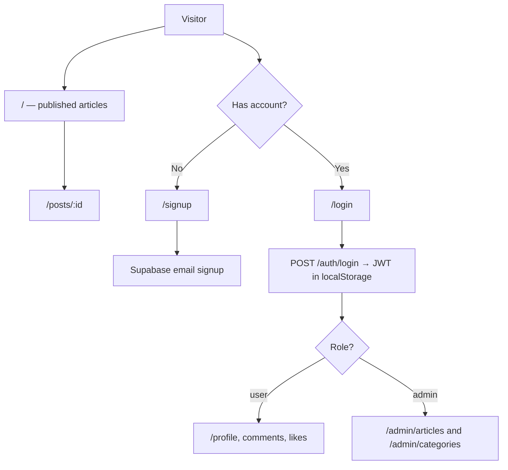

# 📌 Personal Blog — Anime & Movie Reviews (Frontend)

> Web client for a personal blog of anime and movie reviews — visitors browse, search, and filter articles; members comment, like, and edit their profile; admins publish articles and manage categories.

[]()
[]()
[]()
[]()

**Live:** https://anime-recommondation.vercel.app  
**API:** https://anime-recommondation-server.onrender.com  
**Backend repo:** [SalmonPiradon/anime-recommondation-server](https://github.com/SalmonPiradon/anime-recommondation-server)

---

## 📖 Table of Contents

- [Features](#-features)
- [Website Flow](#-website-flow)
- [Tech Stack](#-tech-stack)
- [Architecture](#-architecture)
- [Project Structure](#-project-structure)
- [Getting Started](#-getting-started)
- [Environment Variables](#-environment-variables)
- [Authentication](#-authentication)
- [Demo Credentials](#-demo-credentials)
- [Main Routes](#-main-routes)
- [Backend Integration](#-backend-integration)
- [Known Limitations](#-known-limitations)
- [Deployment](#-deployment)
- [Contributors](#-contributors)

---

## ✨ Features

- **Visitor** — read the landing page and article detail without an account; search by keyword, filter by category, and page through published articles
- **Member** — sign up and log in, comment on an article, like or unlike it, edit name / username / profile photo, and change password
- **Admin** — create, edit, and delete articles (cover image, Markdown content, draft or publish) and manage categories; profile and password pages under `/admin`
- **Article page** — renders post content as Markdown

---

## 🌐 Website Flow



**In short:**

1. Anyone can open `/` and `/posts/:id`. The article list only requests published posts.
2. **Signup** calls `POST /auth/register`. The page stays on a success state; it does not log the user in.
3. **Login** stores `access_token` in `localStorage`, then `GET /auth/get-user` loads the profile.
4. **Members** use `/profile` and `/reset-password`. Comments and likes on an article require a token.
5. **Admins** (`role === "admin"`) enter `/admin`. Other logged-in users are sent back to `/`.

New accounts are created with role `user`. Admin access is a `users.role` value of `admin` in the database.

---

## 🛠️ Tech Stack

| Layer | Technology |
|-------|------------|
| **Frontend** | React 19, Vite 8, React Router 7 |
| **Styling** | Tailwind CSS v4, Radix UI, Lucide icons, Sonner toasts |
| **HTTP** | axios (`VITE_API_BASE_URL`) |
| **Auth** | Supabase session JWT, stored in `localStorage` |
| **Content** | `react-markdown` on the article page |
| **Backend** | [anime-recommondation-server](https://github.com/SalmonPiradon/anime-recommondation-server) (Express on Render) |
| **Database** | PostgreSQL (accessed via the API — no schema in this repo) |

---

## 🏗️ Architecture

```
┌─────────────┐     HTTPS      ┌──────────────────────────┐
│   Browser   │ ──────────────►│  Vite / React (Vercel)   │
│             │                │  anime-recommondation    │
└─────────────┘                └────────────┬─────────────┘
                                            │ REST + Bearer JWT
                                            ▼
                               ┌──────────────────────────┐
                               │  Express API (Render)    │
                               │  anime-recommondation-   │
                               │  server                  │
                               └────────────┬─────────────┘
                                            │
                         ┌──────────────────┼──────────────────┐
                         ▼                  ▼                  ▼
                  ┌─────────────┐   ┌─────────────┐   ┌─────────────┐
                  │  Supabase   │   │ PostgreSQL  │   │  Supabase   │
                  │  Auth       │   │             │   │  Storage    │
                  └─────────────┘   └─────────────┘   └─────────────┘
```

---

## 📁 Project Structure

```text
anime-recommendation/
├── src/
│   ├── pages/                  # Route screens
│   │   ├── LandingPage.jsx
│   │   ├── ArticleDetail.jsx
│   │   ├── LoginPage.jsx
│   │   ├── SignupPage.jsx
│   │   ├── ProfilePage.jsx
│   │   ├── ResetPasswordPage.jsx
│   │   └── admin/              # Article, category, profile, notification
│   ├── components/
│   │   ├── auth/               # AdminRoute
│   │   ├── page-components/    # Nav, hero, article list, layouts
│   │   └── ui/                 # Shared form controls
│   ├── contexts/authentication.jsx
│   └── utils/jwtInterceptor.js # Attaches Bearer token; clears it on 401
├── vercel.json                 # SPA rewrite to index.html
└── package.json
```

---

## 🚀 Getting Started

### Prerequisites

- Node.js 18+
- npm
- [Backend API](https://github.com/SalmonPiradon/anime-recommondation-server) running locally on port **4000**

### Install and run

```bash
git clone https://github.com/SalmonPiradon/anime-recommondation.git
cd anime-recommondation
npm install
npm run dev
```

Create a `.env` file before starting the app (see [Environment Variables](#-environment-variables)).

Open [http://localhost:5173](http://localhost:5173).

### Scripts

| Command | Description |
|---------|-------------|
| `npm run dev` | Start the Vite development server |
| `npm run build` | Production build |
| `npm run preview` | Preview the production build |
| `npm run lint` | Run ESLint |

---

## 🔐 Environment Variables

Create `.env` in this folder. **Never commit secrets.**

| Variable | Required | Local | Production |
|----------|----------|-------|------------|
| `VITE_API_BASE_URL` | Yes | `http://localhost:4000` | `https://anime-recommondation-server.onrender.com` |

There is no `.env.example` in this repo. Vite only exposes variables prefixed with `VITE_`.

---

## 🔑 Authentication

| Method | Flow |
|--------|------|
| **Email register** | `POST /auth/register` with `{ email, password, username, name }` — role is always `user` |
| **Email login** | `POST /auth/login` → save `access_token` as `localStorage.token` → `GET /auth/get-user` |
| **Reset password** | `PUT /auth/reset-password` with `{ oldPassword, newPassword }` while logged in |
| **Admin** | Same login. `AdminRoute` allows `/admin` only when `user.role` is `admin` |

`src/utils/jwtInterceptor.js` adds `Authorization: Bearer <token>` to axios requests. A 401 whose message includes `Unauthorized` removes the token and sends the browser to `/`.

---

## 🧪 Demo Credentials

**Admin** — [https://anime-recommondation.vercel.app/login](https://anime-recommondation.vercel.app/login)

| Field | Value |
|-------|-------|
| Email | `admin@gmail.com` |
| Password | `Password123` |

After login, open `/admin`. This account's role is `admin`.

---

## 🗺️ Main Routes

| Role | Routes |
|------|--------|
| **Public** | `/`, `/posts/:id`, `/login`, `/signup` |
| **Member** | `/profile`, `/reset-password` |
| **Admin** | `/admin/articles`, `/admin/articles/create`, `/admin/articles/edit/:id`, `/admin/categories`, `/admin/categories/create`, `/admin/categories/edit/:id`, `/admin/profile`, `/admin/notifications`, `/admin/reset-password` |

Logged-out visits to `/profile`, `/reset-password`, and `/admin/*` redirect to `/login`. `/admin` itself redirects to `/admin/articles`.

---

## 📡 Backend Integration

This frontend talks to the **[anime-recommondation-server](https://github.com/SalmonPiradon/anime-recommondation-server)** REST API. Endpoint details are in that repository.

| Group | Example endpoints |
|-------|-------------------|
| **Auth** | `POST /auth/register`, `POST /auth/login`, `GET /auth/get-user`, `PUT /auth/reset-password` |
| **Posts** | `GET /posts`, `GET /posts/:id`, `GET /posts/:id/comments`, `POST /posts/:id/comments`, `GET/POST/DELETE /posts/:id/likes` |
| **Profile** | `PUT /profile` |
| **Categories** | `GET /categories` |
| **Admin** | `GET /posts/admin`, `POST /posts`, `PUT /posts/:id`, `DELETE /posts/:id`, category create/update/delete |

The public list calls `GET /posts` with `page`, `limit`, and optional `keyword` and `category`.

---

## ⚠️ Known Limitations

- **Admin notifications** at `/admin/notifications` are mock data in the page component. There is no notifications API.
- **Author name** on articles is fixed in the API query as `Piradon L.`, not read from the users table.
- **Liking twice** makes the API reject the second insert. The article page treats that error as an unlike and calls `DELETE`.
- **Draft posts** are hidden from `GET /posts`, but `GET /posts/:id` does not check publish status.

---

## 🚢 Deployment

| Service | Platform | Notes |
|---------|----------|-------|
| **Frontend** | Vercel | Set `VITE_API_BASE_URL` in project settings |
| **Backend** | Render | See the [backend repo](https://github.com/SalmonPiradon/anime-recommondation-server) |

`vercel.json` rewrites every path to `/` so React Router can handle it.

The deployed site URL is spelled `anime-recommondation` (the same spelling as the GitHub repo).

---

## 👥 Contributors

| Name | GitHub | Contact |
|------|--------|---------|
| Piradon | [SalmonPiradon](https://github.com/SalmonPiradon) | [piradonleungamornnara@gmail.com](mailto:piradonleungamornnara@gmail.com) |
